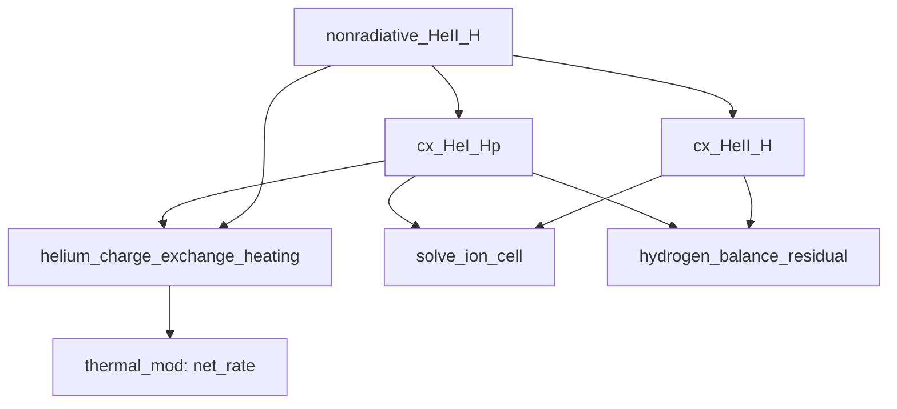

# Implementation Paths Checked on 2026-09-25

These notes describe the source inspected for the review. Follow the live
source when checking later behavior; documentation and comments are not
evidence that a particular implementation remains in use.

> **Superseded (2026-09-26); the tables below are as of 2026-09-25.** Since
> then `cx_HeII_H` adds the Stancil, Lepp & Dalgarno (1998) radiative rate
> `1.20e-15 (T/300)^0.25` to `nonradiative_HeII_H`, which interpolates the
> Loreau et al. (2014) reciprocity table `src/heii_h_charge_exchange_data.inc`
> (1e3-1e6 K, held outside) in place of the KF96 expression; its comment block
> now states the validity range and no longer ties `T^2.06` to curve crossing
> (it describes the KF96 fit it replaced).  The line numbers below no longer
> hold (on 2026-09-27: `solve_ion_cell` line 121, `cx_HeII_H` 666,
> `cx_HeI_Hp` 671, `nonradiative_HeII_H` about 706; `thermal_mod::net_rate` 43).
> The gate `check_helium_charge_exchange.f90` now holds the rate to
> `make_heii_h_charge_exchange.py`'s direct Maxwell averages, not to the KF96
> formula.

## MoCHII rates and callers

| Source | Routine or setting | Observed behavior |
|---|---|---|
| [ion_balance_mod.f90](../../src/ion_balance_mod.f90), line 359 | `cx_HeII_H(T)` | Adds `1.25e-15 * (T/300)^0.25` to `nonradiative_HeII_H(T)`. |
| Same source, line 379 | `nonradiative_HeII_H(T)` | Evaluates the KF96 He+ expression with amplitude `7.47e-15`; uses `min(T, 1e5)` and no lower temperature clamp. |
| Same source, line 364 | `cx_HeI_Hp(T)` | Uses `4 * exp(-DE_HEI_H * ev2erg / (kboltz_cgs*T)) * nonradiative_HeII_H(T)`. |
| Same source, line 416 | `helium_charge_exchange_heating` | Uses the nonradiative forward rate and its reverse for the He0/He+ heat term. The routine also contains a separate He+/He++ term. |
| Same source, line 147 | `solve_ion_cell` | Calls both forward and reverse H/He rate functions when `par%helium_charge_exchange` is true and helium is present. |
| Same source, line 575 | `hydrogen_balance_residual` | Uses the same forward and reverse rates in the written-state hydrogen balance diagnostic. |
| [thermal_mod.f90](../../src/thermal_mod.f90), line 92 | `net_rate` | Calls the helium heating routine when helium exchange and charge-exchange heating are enabled and helium is present. |

The relevant dependency is:



This common dependency is appropriate for a single nonradiative reaction
and its reverse. Any future correction should enter at the physical rate,
so that its consumers remain consistent. The separate He++ reaction rates
require their own physical assessment.

## Existing checks and their limits

| File | Coverage relevant to a future rate change | Limitation |
|---|---|---|
| [check_helium_charge_exchange.f90](../../tests/charge_exchange/check_helium_charge_exchange.f90) | Rate expressions, detailed-balance relations, H/He equilibrium residuals, charge neutrality, and the direction of the exchange effect | Its absolute rate reference repeats the KF96 formula; passing it cannot resolve the literature normalization. |
| [check_charge_exchange_heating.f90](../../tests/charge_exchange/check_charge_exchange_heating.f90), line 247 | Cancellation of heating for the nonradiative He0/He+ pair at its detailed-balance populations | Cancellation tests consistency of the two directions, not the absolute cross section. The driver also covers metal reactions. |
| [run_check.sh](../../tests/charge_exchange/run_check.sh) | Documents how the drivers link against MoCHII objects | It runs several checks; invoking it is broader than checking the He+ normalization alone. |

No Fortran driver was executed for the reference organization. A future
physics edit must rebuild the affected objects and exercise the relevant
H/He and heat paths. Stored executables alone do not prove that the current
source was tested.

## Cloudy c25.00 comparison

The following external files were inspected locally:

- `~/CLOUDY/c25.00/source/atmdat_char_tran.cpp`
- `~/CLOUDY/c25.00/data/ctrecombdata.dat`

`ChargTranEval` first assigns the result of `HCTRecom` to
`CharExcRecTo[ipHYDROGEN][ipHELIUM][0]`. The first He entry in the table has
parameters

```text
a = 1.87e-6, b = 2.06, c = 9.93, d = -3.89
Tmin = 6000 K, Tmax = 100000 K
```

`HCTRecom` clamps the temperature to this interval before evaluating the
fit. `ChargTranEval` then adds the same functional form with amplitude
`7.47e-15 cm^3 s^-1`, using the actual temperature. Define

\[
F(T)=(T/10^4)^{2.06}[1+9.93\exp(-3.89T/10^4)].
\]

The two contributions in the inspected default path are therefore

\[
k_{\rm Cloudy}(T)=1.87\times10^{-15}F(T_c)
                 +7.47\times10^{-15}F(T),
\quad T_c=\min[10^5,\max(6000,T)].
\]

Inside the tabulated interval, the ratio to the unmodified KF96 expression
is `(1.87 + 7.47)/7.47`, approximately 1.25033. It is not a constant ratio
outside the interval. The `lgLeidenHack` branch subsequently replaces this
entry with an UMIST expression; this branch is excluded from the formula
above. This is a source-level evaluation, not a measured Cloudy run.

The surrounding comments identify the table contribution as radiative, but
the table follows the KF96 shape instead of the radiative `T^0.25` fit.
This mismatch prevents using this code path to decide which physical
normalization should be adopted in MoCHII.

## Statements requiring a later source-comment edit

The production source was not edited during this organization. Its current
comment describing `T^2.06` as a necessary consequence of curve crossing
overstates what the cited fit establishes. The empirical low-temperature
extrapolation and the upper temperature clamp should be documented as
implementation choices with unverified accuracy outside the fitted range.

The common calculation of a rate, its reverse, and heating is a consistency
property. It does not independently validate the rate data or all energy
approximations in the surrounding module.
